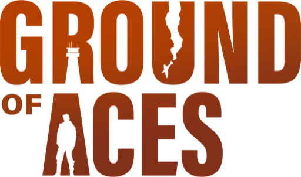

<p align="center">
  
</p>

<h1 align="center">Ground of Aces Modkit</h1>

> [!CAUTION]
> **Developer Preview - subject to change. Currently by invitation only. Use at your own risk.**
> Access: email your GitHub username to [jan@blindflugstudios.com](mailto:jan@blindflugstudios.com) or [moritz@blindflugstudios.com](mailto:moritz@blindflugstudios.com).
> Everything here - docs, tools, rules and the game's modding features - may change without notice.
> Back up your saves before you try a mod.

<p align="center">
  Build missions, quests, event scripts, maps and more for
  <a href="https://store.steampowered.com/app/2308690/Ground_of_Aces/">Ground of Aces</a>.<br>
  By hand, or with an AI agent that knows the rules.
</p>

<p align="center">
  <a href="https://blindflugstudios.github.io/goa-modkit/"><b>Read the manual</b></a> ·
  <a href="https://discord.com/channels/1006159027157356587/1551969822911242240">Discord</a> ·
  <a href="https://steamcommunity.com/app/2308690/workshop/">Steam Workshop</a>
</p>

---

## Start here

- **Never programmed?** Follow [Your first mod](https://blindflugstudios.github.io/goa-modkit/basics/first-mod/). It takes five minutes and needs nothing but the game and a text editor. To let an AI agent build mods for you, continue with [Get started with AI modding](https://blindflugstudios.github.io/goa-modkit/start/).
- **Know your way around files?** Pick one from [`examples/`](examples/), copy its files into `Mods/<your_mod>/Missions/` in the game's data folder, change them, and load your save again from the main menu. [Examples](https://blindflugstudios.github.io/goa-modkit/examples/) explains each one.
- **Using an AI agent?** Claude Code, Codex, or the open-source [OpenCode](https://blindflugstudios.github.io/goa-modkit/ai/opencode/) (free to install; its AI models are mostly paid per use, the few free ones are limited-time and weaker).

  ```bash
  gh repo clone blindflugstudios/goa-modkit
  cd goa-modkit
  claude        # or: codex, opencode
  ```

  Then say what you want to build. The agent reads [`AGENTS.md`](AGENTS.md) and the skills, writes the mod into `mods/`, checks it and installs it.

## What is in here

| Folder | What it is |
|---|---|
| [`docs/`](docs/) | The manual, in English and German - also on the [website](https://blindflugstudios.github.io/goa-modkit/) |
| [`examples/`](examples/) | Working mods, from a single mission to a whole campaign |
| [`templates/`](templates/) | An empty, valid starting point for each kind of mod |
| [`mods/`](mods/) | Where **your** mods go. Git ignores it, so updating the kit never touches your work |
| [`tools/validator/`](tools/validator/) | Checks a mod for the mistakes that crash the game, before you start it |
| [`AGENTS.md`](AGENTS.md), [`CLAUDE.md`](CLAUDE.md) | The rulebook for AI agents |
| [`.agents/skills/`](.agents/skills/), [`.claude/`](.claude/), [`.opencode/`](.opencode/) | Recipes and helper agents for Claude Code, Codex and OpenCode |
| [`generated/`](generated/) | Reference data exported from the game (ids, events, locations) |

## Keep it up to date

```bash
git pull
```

Your own mods in `mods/` stay exactly as they are.

## Contributing

Fixes, examples, skills and translations are welcome - see [CONTRIBUTING.md](CONTRIBUTING.md).

## Licenses

- Tools: [MIT](LICENSE)
- Documentation: [CC BY 4.0](LICENSE-docs)
- Examples and templates: [CC0](LICENSE-examples) - copy them into your mods freely
- The Ground of Aces and Blindflug Studios names and logos are trademarks and not covered by any of these. See [TRADEMARKS.md](TRADEMARKS.md).

Made by [Blindflug Studios](https://www.blindflugstudios.com).
